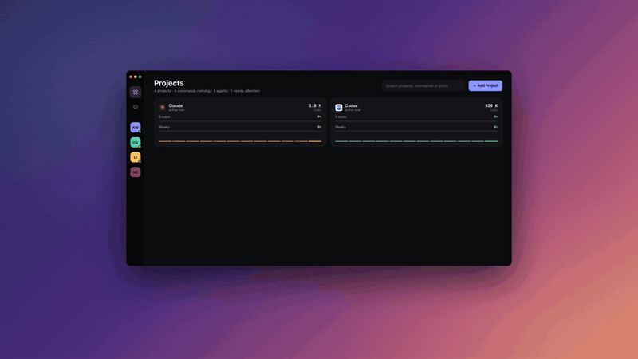
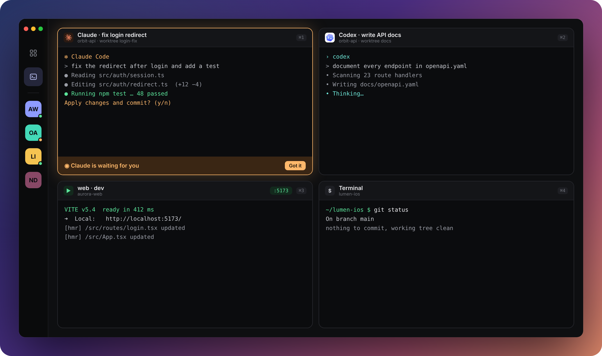

<p align="center">
  
</p>

<p align="center">
  <a href="#install"></a>
  
  
  <a href="LICENSE"></a>
  <a href="https://www.linkedin.com/in/sedatgulmen"></a>
</p>

<p align="center">
  <b>English</b> · <a href="README.tr.md">Türkçe</a>
</p>

---

**DevApp** is a native macOS app for people who juggle several projects and several AI coding agents at once.
Instead of opening a new terminal tab for every dev server, every `claude` and every `codex` session, you add your
project folders once and run, watch and manage everything from a single window.

<p align="center">
  <a href="docs/video/devapp-promo.mp4"></a>
  <br>
  <sub>▶ <a href="docs/video/devapp-promo.mp4">Watch the 35-second video</a> (with sound)</sub>
</p>

<p align="center">
  
</p>

<sub>Screenshots and video use sample projects. DevApp speaks English and Turkish (Settings › General).</sub>

## Highlights

|   |   |
|---|---|
| **One-click run** | Commands are detected when you add a project — `package.json` scripts (npm / pnpm / yarn / bun), Makefile targets, Docker Compose, Procfile, Flutter, Django, Rails, Cargo, Go and SwiftPM. Press ▶ on a command or **Start** on the project to launch everything that belongs together. |
| **Ports that make sense** | Ports are read from `--port`, `.env`, `vite.config`, compose mappings or framework defaults. Change a port inline, let DevApp find a free one, and see conflicts across all projects before they bite. If a port is taken, DevApp shows which process holds it and can stop it for you. |
| **Monorepo aware** | `web/`, `api/`, `apps/*`, `packages/*`, `services/*` … each sub-project gets its own commands and ports, grouped on the project screen. |
| **Real terminals** | Every session is a real PTY ([SwiftTerm](https://github.com/migueldeicaza/SwiftTerm)), so `vim`, `htop`, Claude Code and Codex TUIs work as usual. Grid or focus layout, `⌘1…⌘9` to jump. |
| **Built for AI agents** | Start Claude or Codex in a project with one key, optionally with a first prompt. Spawn several agents at once, each in its own **git worktree**. When an agent rings the bell or a long job finishes, the session turns orange and the Dock shows a badge. |
| **Claude & Codex usage** | 5-hour and weekly limit usage with reset countdowns, today’s tokens and a 12-hour chart — read from local Claude Code / Codex logs. |
| **Desktop widgets** | A usage widget and a projects widget for the macOS desktop. Page through projects with the arrows, click one to jump straight into it. |
| **Dock menu** | Right-click the Dock icon to see every open terminal grouped by project, start or stop projects, or jump to whatever is waiting for you. |
| **Agent health check** | Settings › Agents shows whether Claude Code and Codex are installed (path and version), signed in and recently used, with one-click install and sign-in. Usage cards warn when an agent isn’t connected. |
| **English & Turkish** | Switch the language in Settings, or follow your Mac’s language. Widgets and the Dock menu follow along. |
| **Stays put** | Projects, commands, ports and sessions are saved on every change and come back after a restart. |

<p align="center">
  
</p>

<p align="center">
  
</p>

<p align="center">
  
</p>

## Install

Requirements: **macOS 14 Sonoma or later** and **Xcode 16+**.

### Quick start (no widgets)

```bash
git clone https://github.com/gulmensedat/devapp.git
cd devapp
swift run                                   # or: open Package.swift → ⌘R
./scripts/build-app.sh release --install    # build DevApp.app into /Applications
```

### Full build with desktop widgets

WidgetKit extensions can’t be built by Swift Package Manager, so the full app uses an Xcode project generated by
[XcodeGen](https://github.com/yonaskolb/XcodeGen). Widgets have to be signed — a free Apple ID works.

```bash
brew install xcodegen
echo YOUR_TEAM_ID > .devapp-team   # Xcode › Settings › Accounts › Team ID
./scripts/xcode.sh build           # builds, installs to /Applications and opens DevApp
```

Then right-click the desktop › **Edit Widgets** › **DevApp**.

## Keyboard shortcuts

| Shortcut | Action |
|---|---|
| `⌘0` / `⇧⌘0` | Dashboard / all terminals |
| `⌥⌘R` / `⌥⌘.` | Start / stop the current project |
| `⌥⌘E` | Edit project commands and ports |
| `⌘T` · `⇧⌘C` · `⇧⌘K` | New terminal · Claude · Codex |
| `⌘N` | New session (worktrees, multiple agents, first prompt) |
| `⌘1` … `⌘9` | Focus terminal 1–9 |
| `⌘↩` | Toggle grid / focus layout |
| `⌘J` | Jump to the session that needs you |
| `⇧⌘X` · `⇧⌘F` · `⇧⌘T` | Open in Xcode · Finder · external terminal |
| `⇧⌘B` | Broadcast input to several terminals |

## Privacy

DevApp runs entirely on your Mac. It has no telemetry and no server of its own.

- Usage numbers come from local logs in `~/.claude/projects` and `~/.codex/sessions`.
- **Optional:** to show Claude’s plan percentage, DevApp reads your Claude Code sign-in from the macOS Keychain
  (you’ll be asked to allow it) and calls Anthropic’s usage endpoint — the same one Claude Code uses. Off by default.
- The agent check only looks for Claude Code / Codex sign-in files and Keychain entries; it never reads the secret
  or sends anything anywhere.
- State lives in `~/Library/Application Support/DevApp/`.

## How it’s built

```
Sources/DevApp/
  App/        entry point, menus, Dock menu, AppStore (state, focus, persistence)
  Models/     projects, commands, sessions, settings
  Terminal/   TerminalSession — PTY process + a terminal view that survives layout changes
  Services/   command & port detection, port monitor, git worktrees, usage, project icons, launchers
  Shared/     data shared with the widget extension
  Views/      dashboard, project screen, terminal tiles, sheets, settings
Sources/DevAppWidget/   WidgetKit extension
project.yml             XcodeGen definition (app + widget)
```

## Contributing

Issues and pull requests are welcome. Write every UI string as `L("Türkçe", "English")` and read
[`AGENTS.md`](AGENTS.md) for conventions — it’s also what Claude Code and Codex read when they work on this repo.

**Roadmap:** task board · worktree merge & diff · precise agent state via Claude / Codex hooks
· command palette · `.env` management.

## Author

Made by **Sedat** — say hi on [LinkedIn](https://www.linkedin.com/in/sedatgulmen).
If DevApp saves you a few terminal tabs, a ⭐ on the repo helps others find it.

## License

[MIT](LICENSE)
