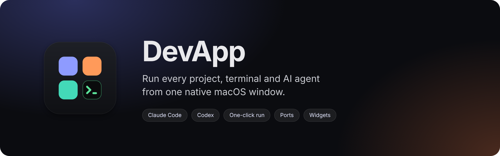
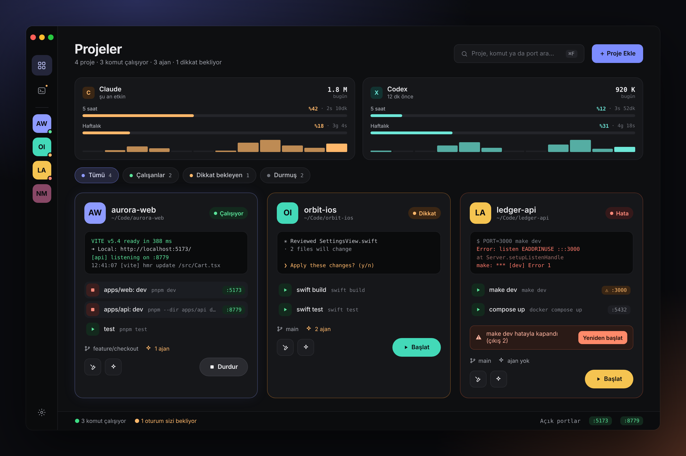
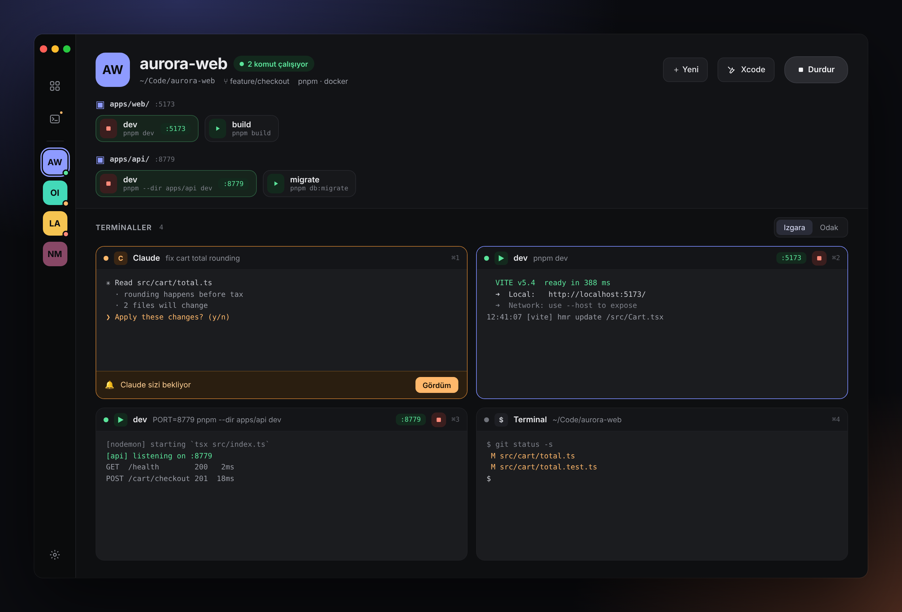
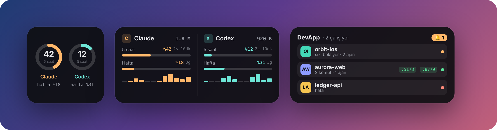

<p align="center">
  
</p>

<p align="center">
  
  
  
  <a href="LICENSE"></a>
</p>

<p align="center">
  <a href="README.md">English</a> · <b>Türkçe</b>
</p>

---

**DevApp**, aynı anda birden fazla projeyle ve birden fazla yapay zekâ kod ajanıyla çalışanlar için yazılmış native bir
macOS uygulaması. Her dev server, her `claude` ve her `codex` oturumu için ayrı terminal açmak yerine proje
klasörlerinizi bir kez eklersiniz; gerisini tek pencereden başlatır, izler ve yönetirsiniz.

<p align="center">
  
</p>

<sub>Ekran görüntülerinde örnek projeler kullanılmıştır. DevApp Türkçe ve İngilizce kullanılabilir (Ayarlar › Genel).</sub>

## Öne çıkanlar

|   |   |
|---|---|
| **Tek tıkla çalıştır** | Proje eklenince komutlar otomatik bulunur: `package.json` script'leri (npm / pnpm / yarn / bun), Makefile hedefleri, Docker Compose, Procfile, Flutter, Django, Rails, Cargo, Go ve SwiftPM. Komutta ▶'e ya da projede **Başlat**'a basın; birlikte çalışması gereken her şey açılsın. |
| **Akıllı portlar** | Portlar `--port`, `.env`, `vite.config`, compose eşlemeleri ya da framework varsayılanlarından okunur. Portu yerinde değiştirin, boş port buldurun, projeler arası çakışmaları önceden görün. Port doluysa DevApp onu tutan süreci gösterir ve isterseniz kapatır. |
| **Monorepo uyumlu** | `web/`, `api/`, `apps/*`, `packages/*`, `services/*` … her alt projenin kendi komutları ve portları olur; proje ekranında gruplanır. |
| **Gerçek terminal** | Her oturum gerçek bir PTY ([SwiftTerm](https://github.com/migueldeicaza/SwiftTerm)); `vim`, `htop`, Claude Code ve Codex arayüzleri olduğu gibi çalışır. Izgara ya da odak düzeni, `⌘1…⌘9` ile geçiş. |
| **Yapay zekâ ajanları için** | Claude ya da Codex'i tek tuşla, isterseniz ilk görevle başlatın. Aynı anda birden fazla ajanı her biri kendi **git worktree**'sinde açın. Ajan zil çaldığında ya da uzun bir iş bittiğinde oturum turuncuya döner, Dock'ta sayaç çıkar. |
| **Claude ve Codex kullanımı** | 5 saatlik ve haftalık limit yüzdeleri (sıfırlanmaya kalan süreyle), bugünkü token ve 12 saatlik grafik — yerel Claude Code / Codex kayıtlarından. |
| **Masaüstü widget'ları** | Kullanım widget'ı ve projeler widget'ı. Bir projeye tıklayınca doğrudan o projeye gidersiniz. |
| **Dock menüsü** | Dock simgesine sağ tıklayınca projelere göre açık terminaller, projeyi başlat/durdur ve sizi bekleyen oturumlar. |
| **Ajan bağlantı kontrolü** | Ayarlar › Ajanlar, Claude Code ve Codex'in kurulu olup olmadığını (yol ve sürüm), oturum açık mı ve en son ne zaman kullanıldığını gösterir; tek tıkla kurulum ve giriş. Bağlı olmayan ajan kullanım kartında uyarı olarak görünür. |
| **Türkçe ve İngilizce** | Dili Ayarlar'dan seçin ya da Mac'in dilini izlesin. Widget'lar ve Dock menüsü de aynı dile geçer. |
| **Kalıcı** | Projeler, komutlar, portlar ve oturumlar her değişiklikte kaydedilir; bilgisayar yeniden başlasa da geri gelir. |

<p align="center">
  
</p>

<p align="center">
  
</p>

## Kurulum

Gereksinimler: **macOS 14 Sonoma ya da üstü** ve **Xcode 16+**.

### Hızlı başlangıç (widget'sız)

```bash
git clone https://github.com/gulmensedat/devapp.git
cd devapp
swift run                                   # ya da: open Package.swift → ⌘R
./scripts/build-app.sh release --install    # DevApp.app'i /Applications'a kurar
```

### Masaüstü widget'lı tam sürüm

WidgetKit eklentileri Swift Package Manager ile derlenemediği için tam sürüm
[XcodeGen](https://github.com/yonaskolb/XcodeGen) ile üretilen bir Xcode projesi kullanır. Widget'ların imzalanması
gerekir — ücretsiz bir Apple ID yeterli.

```bash
brew install xcodegen
echo TAKIM_ID > .devapp-team       # Xcode › Settings › Accounts › Team ID
./scripts/xcode.sh build           # derler, /Applications'a kurar ve açar
```

Sonra masaüstüne sağ tık › **Widget'ları Düzenle** › **DevApp**.

## Kısayollar

| Kısayol | İşlem |
|---|---|
| `⌘0` / `⇧⌘0` | Pano / tüm terminaller |
| `⌥⌘R` / `⌥⌘.` | Projeyi başlat / durdur |
| `⌥⌘E` | Komutları ve portları düzenle |
| `⌘T` · `⇧⌘C` · `⇧⌘K` | Yeni terminal · Claude · Codex |
| `⌘N` | Gelişmiş yeni oturum (worktree, çoklu ajan, ilk görev) |
| `⌘1` … `⌘9` | 1–9. terminale odaklan |
| `⌘↩` | Izgara / odak düzeni |
| `⌘J` | Sizi bekleyen oturuma git |
| `⇧⌘X` · `⇧⌘F` · `⇧⌘T` | Xcode · Finder · harici terminalde aç |
| `⇧⌘B` | Birden fazla terminale aynı anda yaz |

## Gizlilik

DevApp tamamen Mac'inizde çalışır; telemetri ya da kendine ait bir sunucusu yoktur.

- Kullanım bilgileri `~/.claude/projects` ve `~/.codex/sessions` altındaki yerel kayıtlardan okunur.
- **İsteğe bağlı:** Claude plan yüzdesi için DevApp, Claude Code oturumunuzu macOS Anahtar Zinciri'nden okur (izin
  istenir) ve Claude Code'un kullandığı Anthropic kullanım adresini çağırır. Varsayılan olarak kapalıdır.
- Ajan kontrolü yalnızca Claude Code / Codex giriş dosyalarına ve Anahtar Zinciri kaydının varlığına bakar; gizli
  anahtarı okumaz, hiçbir yere göndermez.
- Uygulama verisi `~/Library/Application Support/DevApp/` altındadır.

## Katkı

Hata bildirimi ve pull request'ler memnuniyetle karşılanır. Arayüz metinlerini `L("Türkçe", "English")` ile yazın;
kurallar için [`AGENTS.md`](AGENTS.md) dosyasına bakın —
Claude Code ve Codex de bu depoda çalışırken o dosyayı okur.

**Yol haritası:** görev panosu · worktree birleştirme ve diff · Claude / Codex hook'larıyla kesin
ajan durumu · komut paleti · `.env` yönetimi.

## Lisans

[MIT](LICENSE)
